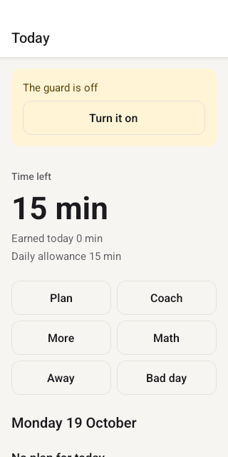

# Future Flow

Earn your scroll time. Future Flow is an Android app where an AI "future you" turns who you want to
become into skills and daily plans, verifies the work with real evidence (GitHub diffs, math
answers checked by a CAS, reading logs), and pays out social-media time from an event-sourced
ledger that a native guard enforces.

> Status: v1.0.0. One owner, one Android phone (a Redmi). Design: `docs/superpowers/specs/`;
> decisions: `docs/adr/`.



## What it does

- **Earn:** a nightly plan of 3–5 tasks from your roadmap. GitHub commits, CAS-checked math and
  reading notes are verified, and passed work pays screen time into a ledger.
- **Spend:** a native Android guard counts time in social apps, games and their sites, and covers
  them with a shield when the time runs out. Emergency unlocks borrow from tomorrow.
- **Stay honest:** a heartbeat tells "phone off" from "guard off"; Android's usage log catches time
  the guard missed; unblocking an app waits until the next day.

## Privacy

- Your location never leaves the phone: away days send only "away or not" and a rounded distance.
- The apps and sites you open never leave the phone: the server sees spent minutes and when.
- The guard reads only which app owns each window and the address bar of Chrome, Brave and Edge.
- Secrets live only in Worker secrets; the GitHub token is sealed at rest; logs carry no personal
  data.

## Run it for real

1. Deploy the API: [docs/deploy.md](docs/deploy.md).
2. Build and install the APK: [docs/release.md](docs/release.md).
3. Pair the phone, switch the guard on, and work through **Keep it running** on the Guard screen.

## Repo layout

| Path                   | What                                                                                           |
| ---------------------- | ---------------------------------------------------------------------------------------------- |
| `packages/core`        | Pure domain rules: time model, ledger, earning, plans, day types, verdicts                     |
| `packages/contracts`   | zod schemas for data crossing system edges                                                     |
| `packages/math-engine` | Ontario math knowledge graph, problem generators, CAS answer checking, Elo, mastery, placement |
| `packages/ai`          | AI router: Gemini talk, Jev judge, structured output, budgets                                  |
| `apps/api`             | Cloudflare Worker (Hono + D1): sync, plans, verification, coach, crons                         |
| `apps/mobile`          | Expo app: pairing, local SQLite store, outbox sync, Today                                      |
| `docs/adr`             | Architecture Decision Records                                                                  |

## Develop

    bun install
    bun run test        # all packages (on a small machine, one package or one file at a time)
    bun run coverage    # with coverage gates
    bun run lint && bun run typecheck

## Phone app (`apps/mobile`)

Expo SDK 57, Android first. Design: [ADR 0011](docs/adr/0011-mobile-local-first.md).

```sh
cp apps/mobile/.env.example apps/mobile/.env   # EXPO_PUBLIC_API_URL
bun run --cwd apps/api dev                     # local Worker on :8787 (SETUP_CODE in .dev.vars)
bun run --cwd apps/mobile start                # Expo dev server: Expo Go or an emulator
bun run --cwd apps/mobile test                 # Jest, with real SQL through node:sqlite
```

- Plan today or tomorrow (propose, edit, add, lock), declare a bad day or an away trip, and answer
  for tasks the checker left pending. Away days are checked on the phone; the location never
  leaves it ([ADR 0012](docs/adr/0012-planning-and-day-types-on-the-phone.md)).
- Math practice on the phone: an optional placement test, problems chosen for your level, checked
  by the CAS on the phone, time earned for real work ([ADR 0013](docs/adr/0013-math-practice-on-the-phone.md)).
- Each new topic opens with a worked and a faded example; timed mock exams for L0–L2 track Gate A;
  accepted word problems are re-verified on the phone ([ADR 0014](docs/adr/0014-learning-loop-on-the-phone.md)).
- Reading log, coach chat (with a fixed 9-8-8 safety line when the coach can't answer), roadmap
  onboarding and GitHub linking ([ADR 0015](docs/adr/0015-reading-coach-onboarding-on-the-phone.md)).
- The guard: a Kotlin module (`modules/usage-guard`) blocks social apps and games with a native
  shield once the time runs out, and counts the minutes spent ([ADR 0016](docs/adr/0016-the-guard-core.md)).
  Its accounting is tested with JUnit in CI (`modules/usage-guard/logic-tests`).
- Staying alive: a foreground service shows the minutes left, and a native heartbeat (queued while
  offline, Doze-proof) tells the server "phone off" from "guard off"
  ([ADR 0017](docs/adr/0017-keeping-the-guard-alive.md)).
- Emergency unlock from the shield (a reason, a 10-minute wait, 10 borrowed minutes, twice a day),
  and a picker for the blocked apps where unblocking waits for the next day
  ([ADR 0018](docs/adr/0018-unlock-and-picker.md)).
- What the guard sees: blocked sites in Chrome, Brave and Edge; blocked apps in picture-in-picture or
  split screen; and time it missed, from Android's usage log
  ([ADR 0019](docs/adr/0019-what-the-guard-sees.md)).
- The phone bundle includes the math checker (CAS), so it's built only in CI or EAS. Never run
  `expo export` on a small machine.
- CI bundles the app for Android. The `Android e2e` workflow pairs a release build with a local Worker
  on an emulator and saves screenshots as the `android-e2e` artifact.
- Installable APK with EAS Build (free plan: 15 Android builds a month), from a `v*` tag:
  [docs/release.md](docs/release.md). A production build refuses to start without an https API
  address or with the emulator flags.

## API (`apps/api`)

Cloudflare Worker (Hono + D1). See `docs/adr/0006-cloudflare-worker-api.md`.

```bash
bun run --cwd apps/api test          # tests inside workerd with a local D1
cp apps/api/.dev.vars.example apps/api/.dev.vars   # then set SETUP_CODE
bun run --cwd apps/api migrate:local
bun run --cwd apps/api dev           # http://localhost:8787/v1/health
```

First deploy (owner only): [docs/deploy.md](docs/deploy.md).

## AI (`packages/ai`)

`talk()` (Gemini, free tier) and `judge()` (Jev when a key is set, else Gemini) behind one router with
structured output, one repair retry, provider fallback and a daily budget. See `docs/adr/0007-ai-router.md`.
Without keys, plans come from a deterministic template.

```bash
bun x wrangler secret put GEMINI_API_KEY --cwd apps/api   # optional, free: https://aistudio.google.com/apikey
bun x wrangler secret put JEV_API_KEY --cwd apps/api      # optional, paid
```

## Judge eval

50 labelled GitHub and reading cases (`apps/api/eval/judge-cases.ts`) run through the production
judge: `bun run --cwd apps/api judge:eval` with the AI keys in `apps/api/.dev.vars`. It writes
`docs/judge-eval/report.md`, which says whether `JUDGE_AUTO_DECIDE` may be turned on: at least 40
cases judged, 95% right when it decides alone, and no confident false pass
([ADR 0020](docs/adr/0020-judge-eval.md)).

## Verification

The hourly cron (and `POST /v1/verify`) collects your commits on linked repositories, asks the
judge about GitHub and reading tasks, and pays rewards for passed tasks. Until the judge's accuracy
is measured, judge verdicts wait for your confirmation (`POST /v1/verdicts/:taskId`). Only commits
on each repository's default branch, authored with an email on your GitHub account, count. See
`docs/adr/0008-verification.md`.

## Coach and upkeep

A half-hourly cron rolls the day over, finds heartbeat gaps (phone off vs. guard disabled), writes
the nightly review and tomorrow's draft plan at 21:00, and summarizes past weeks of chat (deleted after 30 days).
Coach chat: `POST /v1/coach/messages`. See `docs/adr/0009-coach-and-upkeep.md`.

## Word problems

The upkeep cron turns exercises from topics you practised into real-world word problems: math-engine
makes the exercise and its answer, the AI only writes the story, and strict checks (same numbers, no
number words, the same units, rounding instructions kept word for word, and a judge that sees the
answer at ≥ 0.9) decide. Stories stay pending until judge decisions are enabled. The phone syncs them with `GET /v1/math/bank`. See
`docs/adr/0010-word-problems.md`.
